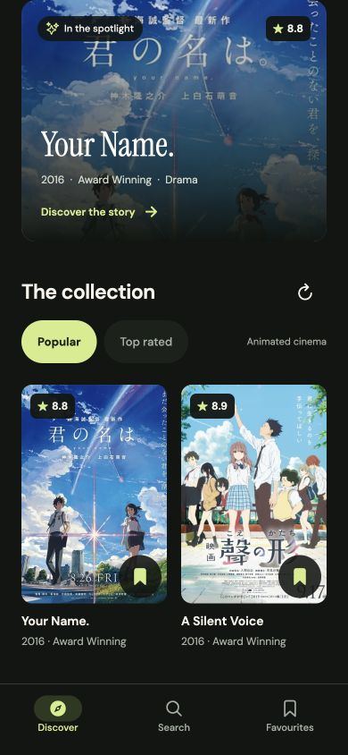
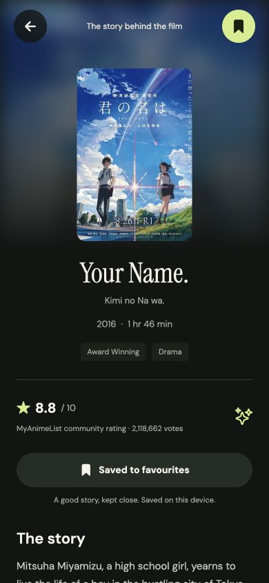
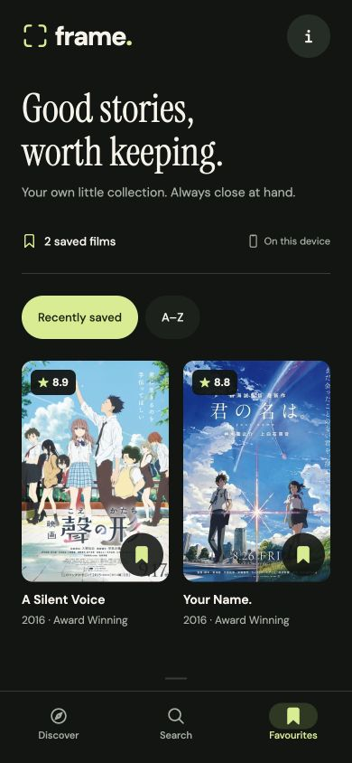

# Frame — Movie Explorer

A phone-first React Native app for discovering a film, reading its story, and keeping a personal watchlist. Frame prioritizes the parts that matter on a slow connection: responsive browsing, useful cached content, clear recovery, and favourites that survive a restart.

Built with **Expo 58 · React Native 0.88 · React 19.3 · TypeScript · Expo Router · TanStack Query · AsyncStorage**.

<p>
  
  
  
</p>

[Watch the two-minute demo](docs/frame-demo.mp4) · [Validation record](docs/VALIDATION.md) · [Desktop screenshot](docs/screenshots/desktop.jpg)

## Run it

Use **Node.js 24** and npm. For native development, also use an Android device/emulator or an iOS simulator.

```bash
git clone https://github.com/paidadharshitha/frame-movie-explorer.git
cd frame-movie-explorer
npm ci
npm start
```

Open the development URL in an Expo Go version compatible with the project's Expo SDK. From the Expo terminal, press `a` for Android or `i` for the iOS simulator. The computer and physical device must be able to reach each other. If the installed Expo Go does not support this SDK, use a development build or the Android preview build below.

For a browser preview:

```bash
npm run web
```

**No API key is needed to try the app.** The default provider is [Tenrai](https://api.tenrai.org/documentation), a public API compatible with the Jikan v4 schema. Its catalog is filtered to **animated films**, and that scope is identified in the app. It is live API data, not a bundled sample list.

### Optional: TMDB general cinema

To browse the broader TMDB movie catalog, copy the environment example and supply your own [TMDB API Read Access Token](https://www.themoviedb.org/settings/api):

```bash
cp .env.example .env
```

```dotenv
EXPO_PUBLIC_TMDB_READ_ACCESS_TOKEN=your_read_access_token
```

Restart Metro after changing the variable:

```bash
npx expo start --clear
```

`EXPO_PUBLIC_` values are bundled into the client and can be read by anyone with the app. This is a client-side demonstration integration, not secret storage. Do not put private server credentials in these variables or commit `.env`. A production app that needs a confidential credential should call a backend it controls.

## What to review

| Requirement | Experience |
| --- | --- |
| Popular movies | A poster-led home screen, paginated feed, and pull-to-refresh |
| Search | A 350 ms debounce, two-character minimum, and separate loading, no-results, and failure states |
| Movie details | Navigation to poster, rating, overview, and a save action |
| Favourites | A dedicated tab with immediate updates and device persistence |
| Slow or lost network | Previously loaded content stays useful; retries and connectivity feedback explain what happens next |

The [manual review checklist](docs/REVIEW_CHECKLIST.md) covers both the happy path and failure cases. Actual checks and their limits are recorded in [VALIDATION.md](docs/VALIDATION.md).

## State and data design

**Remote data belongs to TanStack Query.** Popular pages, search results, and details use independent query keys. The cache is persisted to AsyncStorage, with a 10-minute freshness window and 24-hour retention. Disk persistence keeps up to 12 recent queries and the first two pages of each list, capped below 750 KB; browsing in the current session can continue beyond that. Cache writes evict older data if storage is full, without touching favourites. A failed refresh leaves existing movies visible, and a failed next page allows a retry without discarding earlier pages.

**Favourites belong to the device.** They are stored separately from the expiring query cache, so saving a movie does not depend on a successful network request or on the lifetime of a search result. A movie snapshot keeps a saved title useful when the device is offline. Writes are serialized so rapid taps cannot overwrite a later action. A failed save keeps the latest state in memory and offers a retry; a failed initial read blocks writes so an unreadable collection is not overwritten.

**Screen state stays local.** Search text, selected filters, and short-lived presentation state stay close to the screen that owns them. Provider adapters normalize external data into a shared movie model so the UI does not depend on a particular API response shape.

**Requests are bounded and recoverable.** A 12-second timeout prevents an individual request from hanging indefinitely. Requests are paced, and transient failures get at most two automatic retries. Authentication/client errors, malformed responses, and cancellations are not automatically retried. Debouncing reduces unnecessary searches, cancellation prevents obsolete work from taking priority, and connectivity tracking informs TanStack Query when requests should pause or resume. Native builds use NetInfo; web uses browser connectivity events. Loading a first page, refreshing existing content, and fetching the next page are separate UI states.

Offline support has a deliberate boundary: it can show data already loaded or saved on that device. A first launch without connectivity cannot create a catalog, unseen details require a connection, and poster images still depend on their local image cache. Favourites store metadata, not downloaded film media.

## Project layout

```text
app/                    Expo Router screens and navigation
src/api/                HTTP client, provider adapters, response normalization
src/components/         Shared cards, featured movie, and UI states
src/hooks/              Query hooks, pagination helpers, input debouncing
src/state/              Query persistence, connectivity, favourites store
src/types/              Shared movie and pagination types
src/theme.ts            Visual tokens
tests/                  API, storage, and query-policy unit tests
docs/                   Manual review checklist and recording script
```

The favourites store and query retry policy are plain TypeScript modules, so their failure and concurrency cases can be tested without starting React Native. Query keys include the provider, and saved movie IDs include their provider prefix to prevent catalog collisions.

## Validation

Run the checks from a clean install:

```bash
npm run check
npm run format:check
npm run export:web
npm run export:android
```

**Passed:** TypeScript, ESLint, formatting, all **34 unit tests**, the web production export, and the Android Hermes JavaScript export. Live browser checks covered popular/top-rated movies, page-two pagination, refresh, details, search, empty results, and favourites surviving a full reload. The interface was checked at phone and desktop sizes.

Offline handling and storage failures have unit coverage. Airplane-mode behavior and native devices were not tested, and TMDB was verified with mocked responses only. The Android export is a bundle check, not an APK. See [the validation record](docs/VALIDATION.md) for evidence, remaining checks, and dependency audit findings.

## Android APK

An EAS `preview` build profile is included and requests an installable Android APK. With access to an Expo account:

```bash
npx eas-cli login
npx eas-cli build:configure
npm run build:apk
```

Use the completed build's download URL to install the APK on Android. If using TMDB, configure the same public environment variable for the build; the key-free catalog needs no build secret. The `development` profile is available for an Expo development client, and `production` is reserved for store builds.

No APK is included in this submission; the screen recording is supplied instead. Building an APK requires signing in to Expo and completing the EAS build.

## Submission

- **Repository:** [paidadharshitha/frame-movie-explorer](https://github.com/paidadharshitha/frame-movie-explorer)
- **Recording:** [Two-minute Frame demo](docs/frame-demo.mp4)

The recording shows the real app's phone-sized web preview using live Tenrai data. It is silent, captured at 4 fps, and edited to compress inactive gaps. It demonstrates the web experience; it is not a native-device or APK recording. A [reusable demo script](docs/DEMO_SCRIPT.md) is also included.

## Data and attribution

Default movie metadata is served by [Tenrai](https://tenrai.org/) from the public MyAnimeList catalog. Tenrai is an unofficial service and does not guarantee uninterrupted availability; its current [API documentation](https://api.tenrai.org/documentation) and [terms](https://tenrai.org/terms) describe usage and limits. Posters and metadata remain the property of their respective owners.

When configured, TMDB supplies general cinema metadata and images. **This product uses the TMDB API but is not endorsed or certified by TMDB.** See [TMDB attribution requirements](https://developer.themoviedb.org/docs/faq). The bundled TMDB logo is rendered from the [official documentation's blue logo asset](https://files.readme.io/29c6fee-blue_short.svg), preserving its artwork, colors, and transparency.
