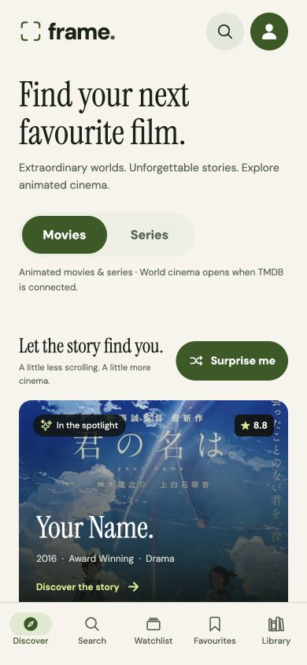
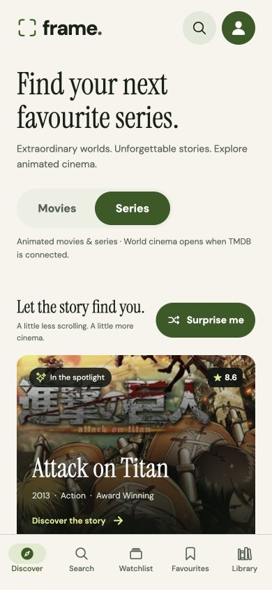
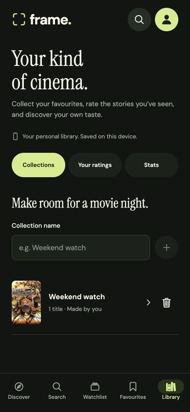
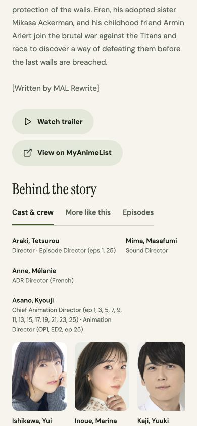
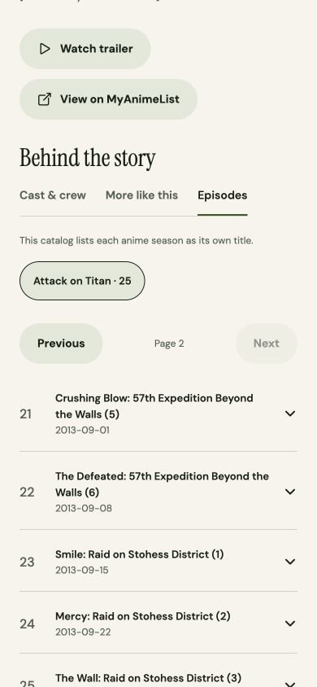
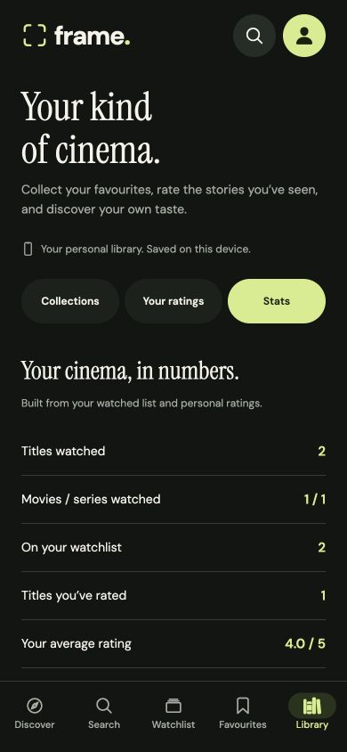

# Frame — Movies, Series & Your Cinema

A phone-first React Native app for discovering movies and series, exploring the people behind them, and building a personal cinema library. Frame prioritizes responsive browsing on slow connections, useful cached content, clear recovery, and personal data that survives a restart.

Built with **Expo 58 · React Native 0.88 · React 19.3 · TypeScript · Expo Router · TanStack Query · AsyncStorage**.

<p>
  
  
  
</p>

[Watch the original baseline demo](docs/frame-demo.mp4) · [Validation record](docs/VALIDATION.md) · [Desktop library](docs/screenshots/desktop-library.jpg)

The existing recording covers the original browsing, search, details, and favourites flow. It predates the newer features shown in these screenshots.

## Run it

Use **Node.js 24** and npm. For native development, also use an Android device/emulator or an iOS simulator.

```bash
git clone https://github.com/paidadharshitha/frame-movie-explorer.git
cd frame-movie-explorer
npm ci
npm start
```

Open the development URL in an Expo Go version compatible with the project's Expo SDK. From the Expo terminal, press `a` for Android or `i` for the iOS simulator. The computer and physical device must be able to reach each other. If the installed Expo Go does not support this SDK, use a development build or the Android preview build below.

For a browser preview:

```bash
npm run web
```

**No API key is needed to try the app.** The default provider is [Tenrai](https://api.tenrai.org/documentation), a public API compatible with the Jikan v4 schema. Choose **Movies** or **Series** to browse animated films or anime TV series. This catalog scope is identified in the app. It is live API data, not a bundled sample list.

### Optional: TMDB general cinema

To browse TMDB movies and TV series, including **Telugu, Hindi, and English original-language filters**, copy the environment example and supply your own [TMDB API Read Access Token](https://www.themoviedb.org/settings/api):

```bash
cp .env.example .env
```

```dotenv
EXPO_PUBLIC_TMDB_READ_ACCESS_TOKEN=your_read_access_token
```

Restart Metro after changing the variable:

```bash
npx expo start --clear
```

The repository includes no token; the working preview currently uses the key-free animated catalog. Language controls appear when TMDB is configured. They filter a title’s original language, not its available dubs, subtitles, or playback language. TMDB search applies this filter to each returned page and preserves pagination, so a page with no matches can still offer more results. TMDB details include seasons and episodes where the service supplies them.

`EXPO_PUBLIC_` values are bundled into the client and can be read by anyone with the app. This is a client-side demonstration integration, not secret storage. Do not put private server credentials in these variables or commit `.env`. A production app that needs a confidential credential should call a backend it controls.

## What to review

| Requirement              | Experience                                                                                                                                     |
| ------------------------ | ---------------------------------------------------------------------------------------------------------------------------------------------- |
| Movies and series        | Switch catalogs on Discover or Search; popular/top-rated lists, infinite scroll, and pull-to-refresh                                           |
| Language browsing        | TMDB original-language filters for Telugu, Hindi, English, or all languages                                                                    |
| Search                   | A 350 ms debounce, two-character minimum, and separate loading, no-results, and failure states; results stay scoped to media type and language |
| Title details            | Navigation to poster, community score, overview, trailers when available, and personal actions                                                 |
| Cast and recommendations | Cast/voice actors, director or other listed creators, and navigable “More like this” suggestions                                               |
| Seasons and episodes     | Season selection and expandable episode information; at most 20 episode rows rendered per visible page                                         |
| Favourites               | A dedicated tab with immediate updates and device persistence                                                                                  |
| Your rating              | Personal 1–5 stars, shown separately from community scores; rating marks a title watched, and clearing a rating keeps its watch history        |
| Custom collections       | Create named lists, add titles from details, rename lists, and remove titles or collections with Undo                                          |
| My cinema stats          | Watched movies/series, planned titles, personal rating average, favourite genres, and highest-rated titles derived from your activity          |
| Appearance               | Light, dark, or system appearance from the account screen, saved on the device; subtle button feedback and reduced-motion support              |
| Personalised discovery   | “Surprise me” favours genres from saved favourites, skips watched films, and explains each pick                                                |
| Collection filters       | Combine genre, a rating of 8+, and hide-watched filters, with a clear count of matching loaded films                                           |
| Watchlist and film diary | Separate Planned and Watched lists, watched dates, status badges, and an eight-second Undo after list removal                                  |
| Demo sign-in             | A name/email profile on this device, a restored session, and sign-out; guest browsing stays available                                          |
| Title comments           | Local comments on movies and series, with a 1,000-character limit, hidden spoilers, and deletion/Undo for the active profile's own comments    |
| Slow or lost network     | Previously loaded content stays useful; retries and connectivity feedback explain what happens next                                            |

“Surprise me” and genre/rating/watched filters run locally on the titles already loaded. They need no account, send no preference profile to a recommendation service, and do not fetch more pages merely because a local filter changes. With these filters active, the load-more action expands the selection explicitly. “More like this” uses the catalog provider’s related-title data. Favourites remain independent from viewing plans.

In title details, open **Behind the story** for **Cast & crew**, **More like this**, or a series’ **Episodes** tab. Optional sections have their own loading, empty, offline, and retry states. The anime catalog treats each season as a separate title; the app explains this instead of inventing a combined franchise season list. This is a discovery and tracking app, not a movie or episode player.

Open **Library** for **Collections**, **Your ratings**, and **Stats**. Collections start empty; suggested names such as “Weekend watch” only fill the name field. Your ratings and watch history supply the statistics, including separate watched-movie and watched-series counts. No viewing hours or other unmeasured activity are invented.

<p>
  
  
  
</p>

The [manual review checklist](docs/REVIEW_CHECKLIST.md) covers both the happy path and failure cases. Actual checks and their limits are recorded in [VALIDATION.md](docs/VALIDATION.md).

## Try the local profile and comments

Open the **person icon** in the header and enter a display name and email. This is a device-only demo: no password is collected, the email is not verified, and no server account is created. Using the same email again restores the same local identity. About Frame is available from this profile screen.

Open a movie or series and tap the comment icon beside its community score to jump to the discussion. Add personal stars in **Your rating** and a written review in the comments below. Mark a comment as a spoiler to hide its text until a reader chooses to reveal it. You can delete comments written by your active local profile and undo that deletion within eight seconds. Signing out keeps the comments; you can continue browsing as a guest.

Profiles and comments stay on this device and are not shared across devices or synced to a cloud service. Favourites, Watchlist, ratings, and custom collections are shared device data regardless of which demo profile is active. Personal stars require no sign-in; comments have local authorship. The account screen also contains **Appearance → System / Light / Dark**, available to guests.

## State and data design

**Remote data belongs to TanStack Query.** List and search keys include the provider, media type, and language; lists also include sort order and searches include the search term. Details, credits, recommendations, seasons, and episode pages use separate keys, with title and season IDs where appropriate. Optional detail sections fetch independently, so a failed cast request cannot block the saved overview. The cache is persisted to AsyncStorage, with a 10-minute freshness window and 24-hour retention. Disk persistence keeps up to 12 recent queries and the first two pages of each list, capped below 750 KB; browsing in the current session can continue beyond that. Cache writes evict older data if storage is full, without touching personal stores. A failed refresh leaves existing titles visible, and a failed next page allows a retry without discarding earlier pages. Episode navigation renders at most 20 rows at once even when the provider returns a larger page.

**Favourites belong to the device.** They are stored separately from the expiring query cache, so saving a movie does not depend on a successful network request or on the lifetime of a search result. A movie snapshot keeps a saved title useful when the device is offline. Writes are serialized so rapid taps cannot overwrite a later action. A failed save keeps the latest state in memory and offers a retry; a failed initial read blocks writes so an unreadable collection is not overwritten.

**Watch history has its own durable store.** Planned and watched entries keep full movie snapshots under a separate AsyncStorage key, with their added and watched dates. The store validates restored records, serializes writes, and offers recovery without overwriting unreadable data. Undo restores the original entry and dates. Details can use watchlist snapshots even after the query cache expires.

**Ratings and custom collections share a versioned library store.** `@frame/library/v1` contains personal ratings with dates and full title snapshots, plus named collections with creation dates and member snapshots. Names are trimmed, limited to 40 characters, unique without case sensitivity, and capped at 50 collections. Membership and ratings are deduplicated by title ID. Strict hydration rejects a damaged envelope as a whole; mutations wait for recovery. Serialized optimistic writes retain unsaved changes with a visible Retry action. Collection Undo restores its titles and creation date without replacing a newer conflicting list. Detail screens can fall back to these saved snapshots offline. Ratings wait for both library and watchlist hydration before also marking a title watched.

**Local profiles and comments share one store.** `@frame/community/v1` stores profiles, the active profile ID, and comments in one versioned envelope. Hydration validates the entire record before enabling changes. Serialized writes keep rapid sign-in/comment/sign-out actions ordered; a failed write retains the latest in-memory state with a retry, while a failed read leaves the stored data untouched. This models a demo session and authorship, not authentication.

**Appearance is a small separate preference.** `@frame/theme/v1` stores the selected mode. Shared theme tokens update screens, navigation, inputs, and loading states consistently. System mode follows the device appearance, and reduced-motion preferences disable the button scale feedback and navigation transition. Failed preference reads preserve the stored value until recovery; failed writes expose retry.

**Presentation state stays close to its owner.** Discover and Search share a browse context for movie/series and language selection. Search text, local filters, collection forms, and short-lived presentation state remain local. Provider adapters normalize external data into a shared title model so UI components do not depend on a particular response shape. `getCinemaStats` derives counts, genre frequencies, and personal rating summaries without storing a second, potentially stale copy.

**Requests are bounded and recoverable.** A 12-second timeout prevents an individual request from hanging indefinitely. Requests are paced, and transient failures get at most two automatic retries. Authentication/client errors, malformed responses, and cancellations are not automatically retried. Debouncing reduces unnecessary searches, cancellation prevents obsolete work from taking priority, and connectivity tracking informs TanStack Query when requests should pause or resume. Native builds use NetInfo; web uses browser connectivity events. Loading a first page, refreshing existing content, and fetching the next page are separate UI states.

Offline support has a deliberate boundary: it can show data already loaded or saved on that device. A first launch without connectivity cannot create a catalog; unseen cast, recommendations, seasons, or episodes require a connection; poster images depend on their local image cache. Personal stores retain title metadata, not downloaded films or episodes. Saved ratings, collections, and derived statistics remain local actions.

## Project layout

```text
app/                    Expo Router screens and navigation
src/api/                HTTP client, provider adapters, response normalization
src/components/         Shared cards, personal actions, media sections, and UI states
src/hooks/              Query hooks, pagination helpers, input debouncing
src/lib/                Pure discovery, filtering, and cinema-statistics logic
src/state/              Query persistence, browse options, and durable personal stores
src/types/              Shared title, credit, season, episode, and pagination types
src/theme.tsx           Theme context and themed-style hooks
src/theme-tokens.ts     Light/dark palettes and typography
src/theme-preference.ts Validated appearance preference serialization
tests/                  API, storage, stats, discovery, theme, and query-policy tests
docs/                   Manual review checklist and recording script
```

The device stores, discovery/statistics helpers, and query retry policy are plain TypeScript modules, so their edge cases can be tested without starting React Native. IDs distinguish TMDB movies (`tmdb-…`) from TMDB series (`tmdb-tv-…`); anime titles use their unique `jikan-…` catalog IDs. Existing saved movie records remain readable.

## Validation

Run the checks from a clean install:

```bash
npm run check
npm run format:check
npm run export:web
npm run export:android
```

The current unit suite has **123 passing tests**, covering provider normalization and request options, movie/series ID separation, credits and episode data, durable-store failure recovery, rapid writes, personal-rating bounds, collection validation/Undo, derived statistics, theme preferences, and existing discovery/profile/comment behavior.

Final export and browser results for this revision are recorded in [VALIDATION.md](docs/VALIDATION.md), alongside remaining checks and dependency audit findings. Unit coverage of network/storage failure handling is not an airplane-mode or native-device test. TMDB uses mocked-response coverage until a real token is configured and verified. The Android Hermes export checks the JavaScript bundle; it does not produce an APK.

## Android APK

An EAS `preview` build profile is included and requests an installable Android APK. With access to an Expo account:

```bash
npx eas-cli login
npx eas-cli build:configure
npm run build:apk
```

Use the completed build's download URL to install the APK on Android. If using TMDB, configure the same public environment variable for the build; the key-free catalog needs no build secret. The `development` profile is available for an Expo development client, and `production` is reserved for store builds.

No APK is included in this submission; the screen recording is supplied instead. Building an APK requires signing in to Expo and completing the EAS build.

## Submission

- **Repository:** [paidadharshitha/frame-movie-explorer](https://github.com/paidadharshitha/frame-movie-explorer)
- **Recording:** [Original baseline two-minute Frame demo](docs/frame-demo.mp4)

The recording is an **original baseline**, showing browsing, search, details, and favourites before the later discovery, watchlist, profile/comments, series, ratings, collections, stats, and theme additions. It uses the real app's phone-sized web preview with live Tenrai data; it is silent, captured at 4 fps, and edited to compress inactive gaps. It is not a native-device or APK recording. The screenshots show the expanded interface, and the [updated two-minute recording script](docs/DEMO_SCRIPT.md) covers the new features without claiming the old video demonstrates them.

## Data and attribution

Default animated movie and series metadata is served by [Tenrai](https://tenrai.org/) from the public MyAnimeList catalog. Tenrai is an unofficial service and does not guarantee uninterrupted availability; its current [API documentation](https://api.tenrai.org/documentation) and [terms](https://tenrai.org/terms) describe usage and limits. Posters and metadata remain the property of their respective owners.

When configured, TMDB supplies movie and TV metadata and images. **This product uses the TMDB API but is not endorsed or certified by TMDB.** See [TMDB attribution requirements](https://developer.themoviedb.org/docs/faq). The bundled TMDB logo is rendered from the [official documentation's blue logo asset](https://files.readme.io/29c6fee-blue_short.svg), preserving its artwork, colors, and transparency.
